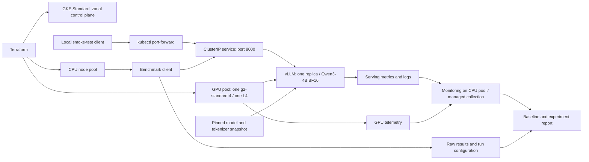
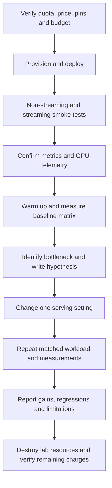

# Phase 1: GCP inference implementation guide

Companion to [PHASE_1_INFERENCE_PLAN.md](PHASE_1_INFERENCE_PLAN.md).
Status: proposed GCP lab; shared S3 state infrastructure must be recreated.
No GCP deployment or performance result is claimed by this document.

## Infrastructure layout and state review

- Use one shared AWS S3 state bucket, managed by
  `infra/common_state/aws/bootstrap`, with one independent state key per root:

  | Terraform root | S3 state key |
  | --- | --- |
  | `infra/common_state/aws/bootstrap` | `infra/common_state/aws/bootstrap/terraform.tfstate` |
  | `infra/pocs/aws_bedrock` | `infra/pocs/aws_bedrock/terraform.tfstate` |
  | `infra/pocs/gcp_inference` | `infra/pocs/gcp_inference/terraform.tfstate` |

- The previous S3 buckets were deleted, according to the operator. Treat this
  as a fresh bootstrap, not a directory rename preserving old remote state.
  Confirm any surviving cloud resources and reconcile them before using empty
  state; bucket deletion alone does not establish that POC resources are gone.
- Review remaining local state, backend caches, overrides and saved plans before
  initialization. Do not reuse stale state or migrate it blindly into the new
  bucket. Create the bucket with local bootstrap state, then migrate that newly
  created state to its S3 key. See the
  [bootstrap runbook](../../infra/pocs/aws_bedrock/README.md#bootstrap-and-plan).
- Keep versioning suspended for POCs and `force_destroy = false`. Enable native
  S3 locking with `use_lockfile = true`; grant access to each root's state and
  `.tflock` objects. Keep the shared bucket until all dependent POCs are removed.
- S3 backend access requires AWS credentials even for the GCP POC; provisioning
  GCP also requires Google Cloud credentials.
- The GCP root now includes provisioning configuration. Follow the
  [GCP Terraform runbook](../../infra/pocs/gcp_inference/README.md) for section 4.
- Keep account IDs, bucket names, endpoints, credentials and raw state out of
  this guide; supply deployment values through ignored local configuration.
- [Agents.md](../../Agents.md) prefers cloud-managed model services and explicitly
  allows inference frameworks such as vLLM. This GKE/vLLM lab is permitted under
  [ADR 0003](../adr/0003_controlled_self_hosted_inference.md), subject to deployment
  registration, synthetic/public evaluation data and the documented access controls.

After recreating and configuring the shared backend, inspect each initialized
root's state. State describes Terraform's last saved view; it does not prove
endpoint health or current cloud drift. Never use the Bedrock root to provision
or destroy the GCP lab.

## 1. Review and scope

The plan makes sense for learning single-GPU serving: start with functional
validation, establish a repeatable baseline, then test one measured change.
Qwen3-4B with BF16 on an L4 is a reasonable starting hypothesis; verify actual
startup memory and sustainable concurrency rather than treating weight size as
proof that every workload fits. GKE adds useful infrastructure experience but
also setup time and overhead to a small inference lab.

This guide makes the following implementation choices explicit:

- Use a zonal GKE Standard cluster and exactly one GPU node in one zone.
- Keep a small CPU node pool for system and monitoring workloads; include its
  cost. Choose its size after reviewing actual resource requests.
- Pin the serving image by digest, model/tokenizer revisions, and benchmark
  client version before provisioning.
- Use a ClusterIP service and local port-forward for smoke tests. Run measured
  load from a separate CPU client in the cluster to reduce tunnel variability.
- Use local `/v1/responses` for smoke tests and measured load, with support
  verified in the pinned vLLM server and benchmark client.
- Specify four workload shapes, four concurrency caps, and three repetitions.
- Select the optimization after reviewing baseline evidence.

## 2. Architecture and experiment flow





## 3. Preflight and reproducibility record

Use a dedicated lab project or clearly isolated resources. Install Terraform,
Google Cloud CLI, the GKE authentication plugin, and kubectl. Authenticate with
the intended project and configure Terraform credentials without committing
credentials or state containing sensitive values.

Record the following in the experiment artifacts before deployment:

| Setting | Required record |
| --- | --- |
| Cloud location | Project ID, region, single zone, quota and available capacity |
| Cluster | GKE version/channel, node image, network and endpoint access |
| Node pools | One GPU node; CPU machine type/count; disk type/size |
| GPU | One L4, driver version, no sharing or time slicing |
| Serving | Image digest, vLLM version, full startup arguments |
| Model | `Qwen/Qwen3-4B`, immutable model and tokenizer commit IDs |
| API | `/v1/responses`, server/client compatibility, `store: false` |
| Generation | Temperature, top-p/top-k, output cap, stop/EOS behavior, seed |
| Load client | Image/version, CPU placement, corpus hash and CLI help |
| Budget | Regional hourly estimate, maximum session duration, billing alert |

Check regional L4 quota, GPU availability and machine pricing. Quota does not
guarantee capacity. The plan's hourly estimate remains provisional: add CPU
nodes, disks, monitoring, networking and cluster management explicitly. Billing
alerts notify; they do not stop spending. Record a teardown time for each lab.
[GPU machine types](https://docs.cloud.google.com/compute/docs/gpus),
[GKE pricing](https://cloud.google.com/kubernetes-engine/pricing).

## 4. Infrastructure to implement

Use the dedicated Terraform configuration in `infra/pocs/gcp_inference` and its
[step-by-step runbook](../../infra/pocs/gcp_inference/README.md). It defines APIs,
networking, GKE, node pools, node identity/IAM and credential-command outputs.
The repository's AWS Terraform configurations are not GCP provisioning commands.

Use one zone for the GPU pool and verify the planned total node count is one;
node counts in multi-zone configurations can multiply across locations. Disable
GPU autoscaling for the initial fixed-hardware comparison. Review upgrade surge
settings because upgrades can temporarily add nodes; avoid upgrades during runs.
Install the supported NVIDIA driver through the chosen GKE configuration and
verify that Kubernetes advertises `nvidia.com/gpu` capacity.
[GKE GPU node pool instructions](https://docs.cloud.google.com/kubernetes-engine/docs/how-to/gpus).

The GKE Terraform module enables system metrics, managed Prometheus and managed
DCGM collection. Use GKE version 1.30.1-gke.1204000 or later and Google-managed
GPU drivers (`DEFAULT` or `LATEST` in Terraform). Do not install a second DCGM
exporter alongside the managed package. Include metric ingestion costs in the
lab budget. See the
[managed DCGM requirements and metric list](https://docs.cloud.google.com/kubernetes-engine/docs/how-to/dcgm-metrics).

Before applying infrastructure, run Terraform formatting, initialization,
validation, and a saved plan in the new configuration directory. Inspect the
plan's machine types, locations, counts and billable resources. Apply that saved
plan only when ready to start the lab. Preserve the provider lockfile and a
sanitized configuration record.

Obtain credentials using the chosen project, zone and cluster name:

```bash
gcloud container clusters get-credentials CLUSTER_NAME \
  --zone ZONE --project PROJECT_ID
kubectl get nodes -o wide
kubectl describe nodes
```

Replace uppercase placeholders before execution. Verify the current kubectl
context belongs to the lab cluster before applying manifests or cleanup commands.

## 5. Serving deployment

Deploy using the checked-in [serving runbook](../../infra/pocs/gcp_inference/serving/README.md)
and these YAML files:

- [namespace.yml](../../infra/pocs/gcp_inference/serving/namespace.yml): dedicated namespace.
- [deployment.yml](../../infra/pocs/gcp_inference/serving/deployment.yml): pinned-image template, one L4, model cache, shared memory and health probes.
- [service.yml](../../infra/pocs/gcp_inference/serving/service.yml): internal port 8000.
- [example.env](../../infra/pocs/gcp_inference/serving/example.env): copy to ignored local `.env` and supply immutable pins.

The runbook covers credentials, capacity checks, rendering, API dry-run, apply,
rollout, smoke tests, troubleshooting and cleanup. Render the Deployment before
applying it; no cloud deployment has been performed or verified by adding these files.

The manifests create a dedicated namespace, a Deployment named `qwen3`, and a ClusterIP Service
named `qwen3` on port 8000. Use one replica and a `Recreate` deployment strategy
so an update does not wait for a second GPU. Request and limit one
`nvidia.com/gpu`; select the intended GPU pool and tolerate its GPU taint.
Set CPU/memory requests after checking node allocatable resources. The GPU node
has only 16 GB system RAM, so leave room for Kubernetes and loading overhead.

Set these serving arguments in the pinned image's supported syntax:

```text
--model Qwen/Qwen3-4B
--revision MODEL_COMMIT
--tokenizer-revision TOKENIZER_COMMIT
--dtype bfloat16
--max-model-len 4096
--tensor-parallel-size 1
--generation-config vllm
```

Record the effective GPU memory utilization, maximum sequences, batched-token
budget, prefix caching and chunked-prefill settings. Verify arguments against
that image's `--help`; do not silently substitute a newer image. Using
`--generation-config vllm` avoids silently inheriting model generation defaults;
send explicit sampling settings in requests.
[vLLM engine arguments](https://docs.vllm.ai/en/latest/configuration/engine_args/).

Allow model downloads through the configured egress path. Provide a model cache
with enough disk space, and record whether it persists between runs. Configure
shared memory for the container and a startup probe generous enough for the
first download/load; use readiness to prevent traffic before the model loads.
Check pod events, logs, GPU memory and system RAM before raising concurrency.
[GKE serving example](https://docs.cloud.google.com/kubernetes-engine/docs/tutorials/serve-llama-gpus-vllm).

## 6. Two generation smoke tests

Once the deployment and service exist, run:

```bash
kubectl -n inference-lab rollout status deployment/qwen3 --timeout=20m
kubectl -n inference-lab logs deployment/qwen3
kubectl -n inference-lab port-forward service/qwen3 8000:8000
```

Leave the port-forward running and use a second terminal for requests. The
Responses API is served locally by vLLM; Qwen3-4B still runs on the lab GPU.
Verify `/v1/responses`, streaming, and all request fields against the pinned
release before deployment. `top_k` and `chat_template_kwargs` are vLLM
extensions. Keep requests stateless with `store: false`; do not use
`previous_response_id` in this lab's baseline.
[vLLM Responses request schema](https://docs.vllm.ai/en/latest/api/vllm/entrypoints/openai/responses/protocol/).

Responses uses `input`, `max_output_tokens`, and typed output/stream events.
[OpenAI Responses migration guide](https://developers.openai.com/api/docs/guides/migrate-to-responses).

Run:

```bash
curl --fail-with-body http://127.0.0.1:8000/v1/models

curl --fail-with-body http://127.0.0.1:8000/v1/responses \
  -H 'Content-Type: application/json' \
  -d '{"model":"Qwen/Qwen3-4B","input":[{"role":"user","content":"Explain an insurance deductible in two sentences."}],"temperature":0.7,"top_p":0.8,"top_k":20,"max_output_tokens":128,"chat_template_kwargs":{"enable_thinking":false},"store":false,"stream":false}'

curl --fail-with-body --no-buffer http://127.0.0.1:8000/v1/responses \
  -H 'Content-Type: application/json' \
  -d '{"model":"Qwen/Qwen3-4B","input":[{"role":"user","content":"Explain an insurance deductible in two sentences."}],"temperature":0.7,"top_p":0.8,"top_k":20,"max_output_tokens":128,"chat_template_kwargs":{"enable_thinking":false},"store":false,"stream":true}'
```

Save responses and logs. Require the expected model identity and nonempty
`output_text` content within message items in the `output` array. The SDK's
`output_text` helper is not a top-level text field in the raw JSON response.
Inspect `status`, errors, and `incomplete_details`. For streaming, collect
`response.output_text.delta` events and require a terminal `response.completed`
event for this smoke test. Retain and report failed, incomplete, or error events;
a closed connection alone is not successful completion. If the output cap causes
an incomplete response, record it and adjust the smoke-test prompt or cap before
claiming success. Capture `usage.input_tokens` and `usage.output_tokens` from the
response or terminal event where supported; omit Chat Completions
`stream_options`. Thinking is disabled through the chat template parameter,
rather than merely removing a reasoning parser. Verify behavior with the pinned
version.
[Qwen vLLM deployment documentation](https://qwen.readthedocs.io/en/latest/deployment/vllm.html).

## 7. Observability before load

Use **Google Cloud Managed Service for Prometheus** for vLLM and the managed
**GKE DCGM metrics package** for the L4. Complete these steps after section 6
and before section 8. These are operator instructions; no collection or cloud
changes have been verified by this document.

### 7.1 Check the cluster and existing collection

Replace uppercase placeholders with values from the lab configuration. Run from
the repository root; keep section 6's port-forward running in another terminal.

```bash
kubectl config current-context
kubectl -n inference-lab get pods -l app=qwen3 -o wide
gcloud container clusters describe CLUSTER_NAME \
  --zone ZONE --project PROJECT_ID \
  --format='yaml(currentMasterVersion,monitoringConfig,loggingConfig)'
kubectl -n gmp-system get pods -o wide
kubectl get clusterpodmonitorings
kubectl get pods -A -o wide
```

- Require a ready `qwen3` pod and the intended lab context.
- The checked-in GKE Terraform module enables managed Prometheus, system metrics,
  DCGM collection and workload logs. Verify the live settings rather than relying
  on defaults. Require a running managed GPU exporter on the GPU node and its
  ClusterPodMonitoring resource; confirm fresh GPU samples in section 7.4.
- Check collector placement and CPU/RAM overhead. Managed collectors run on
  nodes, including the GPU node; record this overhead and keep it consistent.
- The operator needs permission to update the cluster/apply Kubernetes resources
  and view Monitoring data. Check collection identity permissions and egress if
  metrics export fails.

### 7.2 Verify the serving metrics endpoint

```bash
curl --fail-with-body http://127.0.0.1:8000/metrics -o /tmp/vllm_metrics_before.txt
rg '^# (HELP|TYPE) vllm:|^vllm:' /tmp/vllm_metrics_before.txt
```

Require Prometheus text with vLLM series. Save the exact names, labels, units and
histogram buckets from the pinned image. A successful local scrape proves the
endpoint works; section 7.4 verifies ingestion. See
[vLLM production metrics](https://docs.vllm.ai/en/latest/usage/metrics/).

### 7.3 Configure managed scraping of vLLM

The `PodMonitoring` resource lives in
[serving/pod_monitoring.yml](../../infra/pocs/gcp_inference/serving/pod_monitoring.yml)
and is applied separately from Terraform, as described in the
[serving runbook](../../infra/pocs/gcp_inference/serving/README.md#4-check-inference).
After the serving smoke tests pass, validate and apply it from the repository root:

```bash
kubectl apply --dry-run=server -f infra/pocs/gcp_inference/serving/pod_monitoring.yml
kubectl apply -f infra/pocs/gcp_inference/serving/pod_monitoring.yml
kubectl -n inference-lab describe podmonitoring qwen3
```

The manifest selects `app: qwen3` pods in `inference-lab` and scrapes `/metrics`
on the named `http` container port (8000) every 30 seconds.
Keep the 30-second interval unchanged across experiments. Do not create another
scrape configuration for the same target. If the CRD is missing, resolve managed
collection setup before continuing.
[Managed collection setup](https://docs.cloud.google.com/stackdriver/docs/managed-prometheus/setup-managed).

### 7.4 Confirm samples and verify the dashboard

Terraform creates the custom dashboard during section 4, before workload
deployment, from [inference.json.tftpl](../../infra/pocs/gcp_inference/dashboards/inference.json.tftpl).
Keep `enable_dashboards = true` in the lab configuration. Charts remain empty
until the workload and collection are running; dashboard creation does not pass
the readiness gate. In Monitoring → Dashboards, open
`PROJECT_NAME_ENVIRONMENT_inference`. The `dashboard_id` Terraform output records
its resource ID. No dashboard creation script or import is required.

Open **Google Cloud Console → Monitoring → Metrics Explorer** in the lab project.
Select **PromQL**, use a recent time window, and run this combined serving query:

```promql
up{namespace="inference-lab",job="qwen3"} or
vllm:num_requests_running{namespace="inference-lab"}
```

The `or` operator returns the union of both metrics' series; it does not add
their values or require both metrics to exist. Confirm that both metrics are
present and that `up = 1`.

Run each GPU query separately:

```promql
DCGM_FI_DEV_GPU_UTIL{namespace="inference-lab"}
```

```promql
DCGM_FI_DEV_FB_USED{namespace="inference-lab"}
```

Filter every query by the observed `cluster` and `location` labels when the
project has multiple clusters. Require `up = 1` and fresh timestamps over several
scrapes. If selectors return nothing, inspect the unfiltered series and actual
labels; an empty result is not zero utilization. Allow collection/ingestion time.

The provisioned dashboard includes the serving, GPU and RAM panels below.
Restarts/failures are checked separately through the listed sources.
Verify its queries against series confirmed in section 7.2 and the selected GKE
version; change the template if the pinned release uses different names.
For the older KV-cache name, set `dashboard_kv_cache_metric` in local
`terraform.tfvars` and review/apply a new plan.

| Panel | Metric or data source |
| --- | --- |
| Server TTFT / inter-token / end-to-end latency | `vllm:time_to_first_token_seconds`, `vllm:inter_token_latency_seconds`, `vllm:e2e_request_latency_seconds` histograms |
| Server output tokens/second | Rate of `vllm:generation_tokens_total` |
| Running / waiting requests | `vllm:num_requests_running`, `vllm:num_requests_waiting` |
| KV-cache fraction | `vllm:kv_cache_usage_perc`; older releases may expose `vllm:gpu_cache_usage_perc` |
| GPU utilization / allocated memory | `DCGM_FI_DEV_GPU_UTIL` (percent), `DCGM_FI_DEV_FB_USED` / `DCGM_FI_DEV_FB_TOTAL` (MB), per GPU |
| Pod / node RAM | Metrics Explorer: `kubernetes.io/container/memory/used_bytes` and `kubernetes.io/node/memory/used_bytes`; filter lab resources |
| Restarts / failures | Pod status, events, serving logs and benchmark error counts |

Example PromQL for a five-minute diagnostic window:

```promql
histogram_quantile(0.95, sum by (le) (rate(vllm:time_to_first_token_seconds_bucket{namespace="inference-lab"}[5m])))
sum(rate(vllm:generation_tokens_total{namespace="inference-lab"}[5m]))
```

The template includes project, cluster, location and namespace filters (node RAM
uses the whole lab cluster). Preserve those filters when editing panels. Histogram quantiles
are bucket estimates. A five-minute window can mix short benchmark runs; use
client results for per-run percentiles and save server data for the exact UTC
run window. Do not average percentiles or label server throughput as successful
client throughput. Client streaming timing includes network effects; server
metrics measure a different boundary. Preserve both.

### 7.5 Exercise collection and pass the readiness gate

1. Record the UTC start time (`date -u +%FT%TZ`), rerun section 6's streaming
   request several times, and record the UTC end time. This is a telemetry check,
   not a measured baseline.
2. Scrape `/metrics` again to `/tmp/vllm_metrics_after.txt`. Require request/token
   counters and latency histogram counts to increase for successful requests.
3. Verify the same activity reaches Monitoring. Require valid per-GPU memory
   and utilization samples; brief requests may fall between GPU samples, so use
   a longer low-concurrency check if needed. Idle zero utilization is valid;
   missing or invalid values are not.
4. Inspect `kubectl -n inference-lab describe pods -l app=qwen3` and serving logs.
   Require no unexplained restarts, OOMs, collection failures or memory pressure.
5. Save the manifest, before/after scrapes, dashboard queries, metric units,
   collector placement/intervals and exported time series in the dated experiment
   artifacts. Preserve client streaming results alongside server telemetry.

**Proceed to section 8 only when serving, GPU and RAM samples are present and
current.** For missing data, check pod labels/port, PodMonitoring events,
`gmp-system` collector logs, GPU exporter health, IAM and network egress. Fix the
collection path and repeat this gate before increasing concurrency.

## 8. Baseline workload and measurement protocol

### 8.1 Confirm readiness

- Pass section 7.5: serving, GPU and RAM telemetry must be current.
- Run the benchmark client on the separate CPU pool. Keep the API, model/tokenizer
  pins, template, thinking and serving settings fixed.
- Record cold model download/load time separately from measured load.

### 8.2 Set the workload matrix

| Workload | Target input tokens | Output cap | Total before chat overhead |
| --- | ---: | ---: | ---: |
| Short prompt / short output | 128 | 128 | 256 |
| Short prompt / long output | 128 | 512 | 640 |
| Long prompt / short output | 2,048 | 128 | 2,176 |
| Long prompt / long output | 2,048 | 512 | 2,560 |

- Test each shape at concurrency caps **1, 4, 16 and 32**: **16 cells**.
- Use **20 unmeasured warmup requests**, then **200 measured requests** per run.
- Repeat each cell **three times**: **48 measured runs**. If variability requires
  longer runs, increase counts consistently for both configurations and record why.

### 8.3 Freeze the replay corpus

1. Generate synthetic prompts with the pinned tokenizer; save prompts, order,
   seeds and checksum. Replay identical data for matched comparisons.
2. Record actual lengths after chat templating; input plus requested output must
   fit within **4,096 tokens**.
3. Send unrendered user content to avoid double templating. Save rendered prompts
   or token IDs alongside the replay corpus.
4. Fix sampling/EOS settings: use supported ignore-EOS behavior or early stopping
   consistently, and report actual generated tokens.

### 8.4 Validate the benchmark command

Create the CPU client using [benchmark_client.yml](../../infra/pocs/gcp_inference/serving/benchmark_client.yml)
and the [benchmark runbook](../../infra/pocs/gcp_inference/serving/BENCHMARK.md).
It covers image pinning, rendering, apply, CPU placement, CLI/connectivity checks,
pinned tokenizer download, result export and cleanup. The client is a **pod on
the CPU node pool**. From your local terminal, enter its container (no node SSH):

```bash
kubectl -n inference-lab exec -it deployment/benchmark-client -- /bin/bash
```

Inside that shell, use `vllm bench serve` matching the pinned server version.
Save its help output and require `openai-responses` and `--extra-body` support:

```bash
vllm bench serve --help
vllm bench serve \
  --backend openai-responses \
  --base-url http://qwen3.inference-lab.svc.cluster.local:8000 \
  --endpoint /v1/responses \
  --model Qwen/Qwen3-4B \
  --tokenizer /client_cache/tokenizer \
  --dataset-name random \
  --random-input-len 128 --random-output-len 128 \
  --num-prompts 200 --seed 42 \
  --request-rate inf --max-concurrency 1 \
  --extra-body '{"temperature":0.7,"top_p":0.8,"top_k":20,"store":false,"chat_template_kwargs":{"enable_thinking":false}}' \
  --save-result --save-detailed \
  --result-dir /results --result-filename validation.json
```

- Treat this as a synthetic validation example. For measured runs, adapt a
  supported dataset loader to replay section 8.3's frozen corpus. Random data
  alone does not establish a frozen-corpus comparison or represent insurance traffic.
- Inspect a sample request: require Responses `input`, `stream: true` and
  `max_output_tokens` matching the workload cap. Preserve the shown generation
  settings; do not fix `max_output_tokens` in `--extra-body`.
- Adjust input length, output cap and concurrency for each cell; save the exact
  command and corpus reference. Validate flags against the pinned version.
- Use the internal service address only inside the cluster; cluster DNS is
  unavailable from an ordinary local terminal.
  [vLLM benchmark CLI](https://docs.vllm.ai/en/latest/cli/bench/serve/).

### 8.5 Run each cell

1. Start at concurrency **1**, then increase to **4, 16 and 32** while memory
   and errors permit. Assign each run a unique ID and save its configuration.
2. Run **20 warmup requests** with the same workload; exclude them from results.
3. Record UTC start time (`date -u +%FT%TZ`), run **200 measured requests**,
   then record UTC end time. Repeat **three times per cell**.
4. Capture achieved concurrency, request rate, duration, errors and timeouts;
   verify the CPU client is not saturated.
5. Stop runs that repeatedly OOM. Retain failed, skipped and saturated cells
   with their reasons instead of omitting them.

`--request-rate inf` with a concurrency cap measures bounded concurrent load,
not production arrivals. Report achieved concurrency separately from the cap.

### 8.6 Save and review the baseline

- Save raw/detailed client results, commands, corpus evidence, logs and
  server/GPU/RAM telemetry for each exact UTC run window.
- Report streaming TTFT and inter-token timing, p50/p95 end-to-end latency,
  latency distributions, successful output tokens/second and run-to-run variability.
- Keep average time per output token separate from individual inter-token
  latencies, and client measurements separate from server measurements.
- Label optional raw-completion results separately; they cannot replace the
  Responses baseline.
- Complete section 11's evidence and cost checklist, then choose an experiment
  in section 9.

## 9. Choose one controlled experiment

### 9.1 Review baseline evidence

- Use section 8's results to identify queueing, poor throughput, prefill delays
  or repeated shared input prefixes.
- Select the workload cells that demonstrate the issue; retain errors and
  run-to-run variability as evidence.

### 9.2 Choose one experiment

Select one change using the baseline evidence:

| Baseline observation | Candidate experiment | Required control |
| --- | --- | --- |
| Queueing or poor throughput | Change `max_num_batched_tokens` | Same corpus and concurrency |
| Repeated shared input prefixes | Compare prefix caching off/on | Same shared-prefix corpus and cache warmup |
| Long prefills delay decode | Tune chunked-prefill token budget | Same mixed-length request order |

- Check the pinned release's effective settings and defaults first. Enabling an
  already active feature is not a measured change.
- For batching, choose one alternative after inspecting the baseline; a larger
  budget is not automatically better.

[vLLM tuning documentation](https://docs.vllm.ai/en/latest/configuration/optimization/).

### 9.3 Record the hypothesis and success criteria

- Before editing configuration, record the baseline value, candidate value and
  expected benefit.
- Define the primary metric, target improvement and acceptable latency/error
  tradeoffs before running the comparison.

### 9.4 Freeze the comparison workload

- Keep hardware, model/tokenizer and image pins, sampling, corpus, request order
  and concurrency identical between configurations.
- For prefix caching, freeze a dedicated shared-prefix corpus for both sides;
  restart/reset cache consistently and separate cold-cache from warm-cache results.
- For mixed-length requests, preserve the same request order. Record the target
  workload and scope; a new corpus requires a matching baseline run.

### 9.5 Apply and validate the candidate

- Change only the selected serving setting and save the full configuration.
- Restart the replica if required, rerun section 6's smoke tests and confirm
  current serving, GPU and RAM telemetry using section 7's readiness gate.

### 9.6 Repeat matched measurements

- Follow section 8: **20 unmeasured warmup requests**, **200 measured requests**
  and **three repetitions per cell**, with identical procedures on both sides.
- Repeat the full matrix for a general batching change. For a targeted cache or
  mixed-prompt experiment, repeat the defined target workload on both sides and
  state the narrower scope.
- Alternate baseline and candidate runs when practical to expose temporal
  variation. Save unique run IDs, exact UTC windows, raw results and telemetry;
  retain failed and skipped cells with reasons.

### 9.7 Compare and record the outcome

- Use section 11 to compare throughput, latency, errors, memory, variability
  and cost against the predefined success criteria.
- Report gains, regressions and workload limitations; a repeatable regression
  is a valid result.
- Retain the better-supported configuration and record the decision and its
  full startup arguments in the experiment report.

## 10. Two-GPU learning lab

After completing the Qwen3-4B baseline and controlled optimization, deploy
`Qwen/Qwen3-14B` in BF16 on one `g2-standard-24` node: two L4 GPUs, each with
24 GB VRAM, 24 vCPUs, and 96 GB host RAM. Keep the CPU pool and monitoring.
Verify regional pricing, two-GPU quota and capacity before provisioning; the
single-GPU cost estimate does not apply to this node.

- Qwen3-14B has 14.8 billion parameters: approximately 29.6 GB of BF16 weights
  before KV cache, intermediate tensors and runtime overhead. Weights exceed
  one L4's memory; two L4s are a reasonable starting configuration, not a
  guarantee of sustainable concurrency. Quantization or a larger-memory GPU
  changes the GPU requirement.
- Pin new model/tokenizer revisions and verify support in the serving image.
  Request and limit two `nvidia.com/gpu` devices in one pod; retain one replica
  and `Recreate`. Both GPUs cooperate on each request through tensor parallelism.
- Replace the baseline model and parallelism arguments with:

```text
--model Qwen/Qwen3-14B
--revision MODEL_COMMIT
--tokenizer-revision TOKENIZER_COMMIT
--dtype bfloat16
--max-model-len 4096
--tensor-parallel-size 2
--generation-config vllm
```

- Update smoke-test and benchmark model IDs. Keep thinking disabled and preserve
  sampling settings. Recount prompts with the pinned 14B tokenizer/template.
- Rerun both smoke tests and verify telemetry for each GPU. Start at concurrency
  1, then try 4, 16 and 32 only while memory and errors permit. Use the same four
  workload shapes, warmup, request counts and repetitions; retain failed cells.
- Record per-GPU memory/utilization, KV-cache capacity, startup time, latency,
  throughput, errors and full lab cost. Inspect GPU topology and communication
  behavior; two GPUs do not guarantee lower latency.
- Report 4B versus 14B as a model-and-hardware comparison, not evidence of a
  serving optimization or model quality improvement.

Optional comparison on the same two-GPU node, with identical Qwen3-4B pins and
workloads:

| Configuration | Learning goal |
| --- | --- |
| One 4B replica, one GPU, `TP=1`; second GPU idle | Same-node baseline |
| Two independent 4B replicas, one GPU each, `TP=1` | Replica scaling and load balancing |
| One 4B replica, two GPUs, `TP=2` | Tensor-parallel communication and scaling |

For replica scaling, each GPU holds a complete model and the ClusterIP service
distributes connections between ready pods. Verify requests reach both replicas;
connection reuse can skew traffic. Each request uses one replica. For tensor
parallelism, one model is sharded across both GPUs. Keep CPU/RAM allocations
recorded and comparable, and count both GPUs in cost even when one is idle.

[Qwen3-14B model card](https://huggingface.co/Qwen/Qwen3-14B),
[GCP GPU machine specifications](https://docs.cloud.google.com/compute/docs/gpus),
[vLLM parallelism guidance](https://docs.vllm.ai/en/latest/serving/parallelism_scaling/).

## 11. Results and evidence checklist

Save a run manifest, startup logs, smoke responses, raw benchmark JSON, monitoring
exports and charts under a dated experiment directory. Keep baseline and candidate
results separate with unique run IDs. Export artifacts before deleting clients,
pods, disks or monitoring resources.

Use a comparison table with workload, achieved concurrency, successful requests,
errors, output tokens/second, p50/p95 TTFT and end-to-end latency, inter-token
statistics, peak GPU memory, KV-cache use and estimated cost per million output
tokens. Show per-run values or dispersion alongside aggregate results.

Calculate cost as:

```text
successful_output_tokens_per_hour = successful_output_tokens / measured_seconds * 3600
USD_per_million_output_tokens = hourly_serving_cost / successful_output_tokens_per_hour * 1000000
```

Use elapsed wall time for the whole measured run, including time spent on failed
requests. Count output from successful requests only. Report zero-success runs
as undefined cost efficiency. Include GPU VM, CPU/system nodes, cluster fee,
disk and the declared monitoring/network estimate. Keep full lab-session cost
separate from steady-load extrapolation; warmup and idle time still cost money.

Completion requires reproducible Terraform/manifests, both smoke tests, usable
telemetry, the baseline matrix with failures retained, one controlled comparison,
and a report explaining tradeoffs. A repeatable regression is a valid result.
Do not claim model quality improvement from serving benchmarks alone.

## 12. Cleanup and verification

1. Export artifacts and record the experiment's end time.
2. Stop benchmark jobs and local port-forwards.
3. Generate and review a Terraform destroy plan in the dedicated lab state;
   destroy only resources owned by that configuration, including its dashboard.
   For dashboard-only deletion, set `enable_dashboards = false` and follow the
   [dashboard cleanup instructions](../../infra/pocs/gcp_inference/README.md#cleanup).
4. Verify the GKE cluster and GPU/CPU nodes are gone. Inspect disks, snapshots,
   external addresses, load balancers, buckets and retained monitoring/log data.
5. Remove separately created lab resources when no longer needed and record any
   deliberate retention with its estimated cost.
6. Check billing again after usage reporting catches up; immediate absence of a
   billing line is not proof that no charge remains.

Scaling the serving Deployment to zero does not remove a fixed GPU node. Removing
only the GPU pool also leaves the cluster, CPU nodes and supporting resources
billable. Preserve teardown commands and final inventory as completion evidence.
